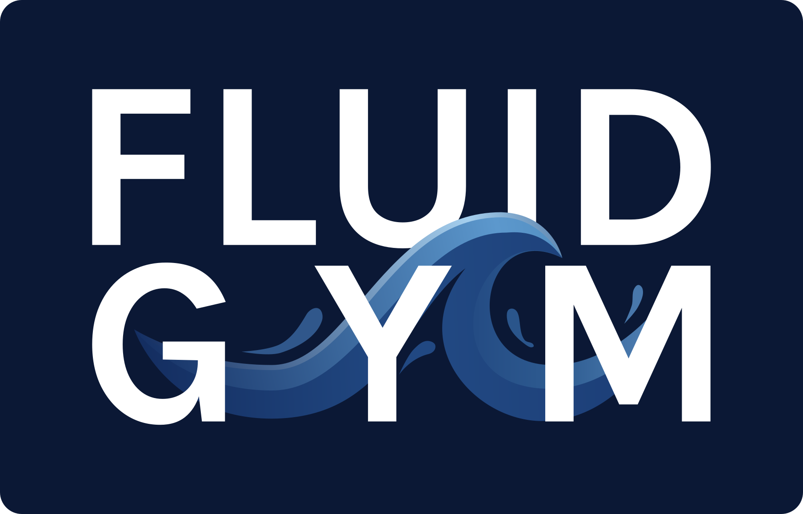
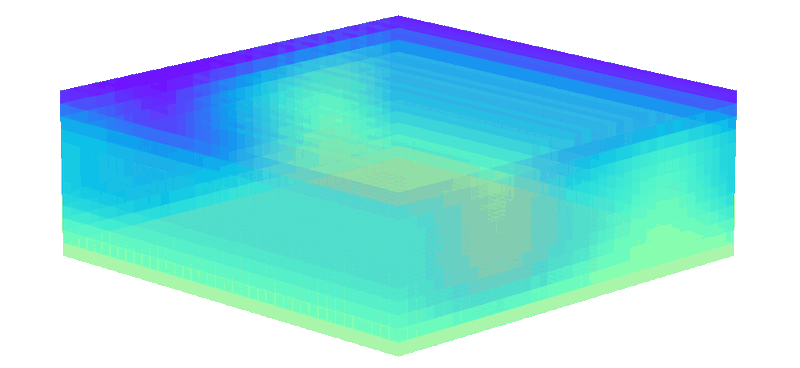
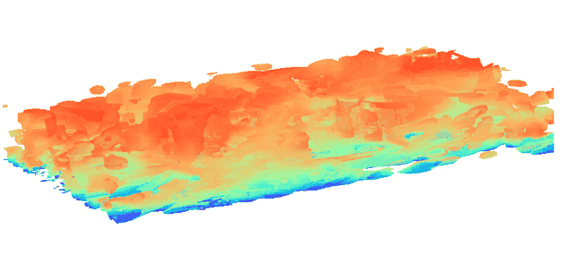

<p align="center">
    <a href="./docs/source/_static/img/logo_v020.png">
        
    </a>
</p>

<h1 align="center">FluidGym: Plug-and-Play Benchmarking of Reinforcement Learning Algorithms for Large-Scale Flow Control</h1>

<table style="border-collapse: collapse; border: none;">
  <tr>
    <td style="border: none; padding: 0;">
      
    </td>
    <td style="border: none; padding: 0;">
      
    </td>
    <td style="border: none; padding: 0;">
      
    </td>
    <td style="border: none; padding: 0;">
      
    </td>
  </tr>
</table>

<div align="center">


[](https://upb-sciml.github.io/fluidgym/docs/installation.html)
[](https://upb-sciml.github.io/fluidgym/docs/installation.html)


</div>
<div align="center">

[](https://github.com/upb-sciml/fluidgym/actions/workflows/linters.yml)
[](https://github.com/upb-sciml/fluidgym/actions/workflows/docs.yml)
[](https://github.com/upb-sciml/fluidgym/actions/workflows/release.yml)

</div>

<div align="center">
    <h3>
      <a href="#-installation">Installation</a> |
      <a href="#-getting-started">Getting Started</a> |
      <a href="https://upb-sciml.github.io/fluidgym/docs/">Documentation</a> | 
      <a href="https://arxiv.org/abs/2601.15015">Paper</a> |
      <a href="#-license-&-citation">License & Citation</a>
    </h3>
</div>

---

## Experimental Results

All results are available on [HuggingFace](https://huggingface.co/datasets/upb-sciml/mhd_control).
This includes phiPICT validation results, RL results & model checkpoints, and inverse design results.

## Installation

### 📦 Installation from PyPI

FluidGym needs Linux, an NVIDIA GPU with a driver for CUDA 12.8 (≥ 570) and
Python 3.11–3.13.

```bash
pip install fluidgym
```

This also installs the solver [phiPICT](https://github.com/upb-sciml/phiPICT)
together with the matching PyTorch (2.10, built with CUDA 12.8). There is no need
to install PyTorch first: phiPICT's compiled extension only works with the PyTorch
version it was built against, so pip replaces any other version. For other
PyTorch/CUDA versions, first install the matching phiPICT wheel from its
[wheel index](https://upb-sciml.github.io/phiPICT/docs/installation.html#other-pytorch-versions-wheel-index)
(or build phiPICT from source), then FluidGym, e.g. for PyTorch 2.14 with CUDA 12.6:
```bash
pip install "torch==2.14.*" --index-url https://download.pytorch.org/whl/cu126
pip install phipict -f https://upb-sciml.github.io/phiPICT/whl/torch-2.14+cu12.html
pip install fluidgym
```

### 🧱 Build from Source

FluidGym itself is pure Python; the CUDA solver comes with phiPICT from PyPI.

1. Create a new conda environment and activate it:
```bash
conda create -n fluidgym python=3.12
conda activate fluidgym
```

2. Clone the repository, enter the directory and install the package:
```bash
pip install .
```

For development, use `make install-dev` instead, which installs the package in
editable mode together with the development dependencies (needs pip ≥ 25.1).

## Getting Started

For an easy start, refer to our [documentation](https://upb-sciml.github.io/fluidgym/) and the [`examples`](examples) directory.
FluidGym provides a ```gymnasium```-like interface that can be used as follows:

```python
import fluidgym

env = fluidgym.make(
    "CylinderJet2D-easy-v0",
)
obs, info = env.reset(seed=42)

for _ in range(50):
    action = env.sample_action()
    obs, reward, term, trunc, info = env.step(action)
    env.render()

    if term or trunc:
        break
```

## License & Citation

This repository is published under the Apache-2.0 license. If you use FliudGym in your work, please cite us:
